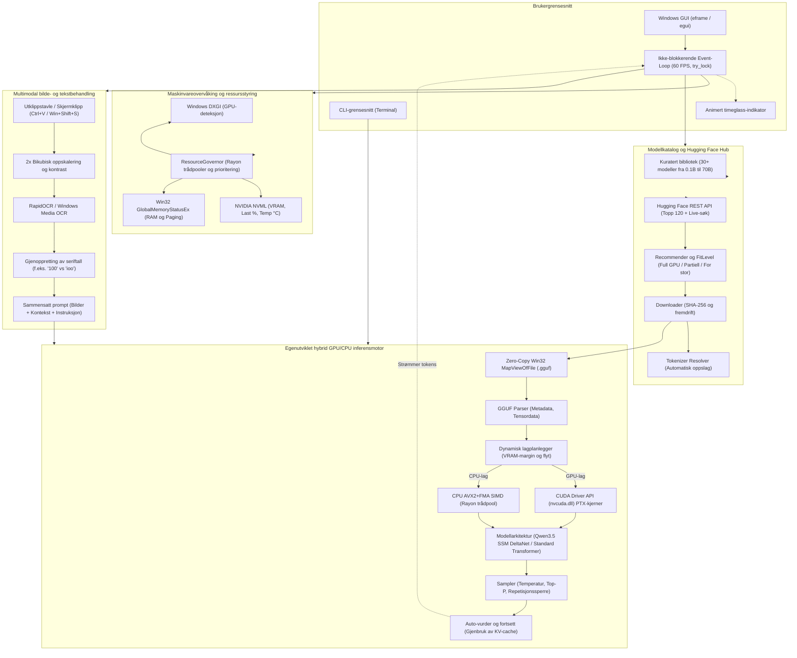
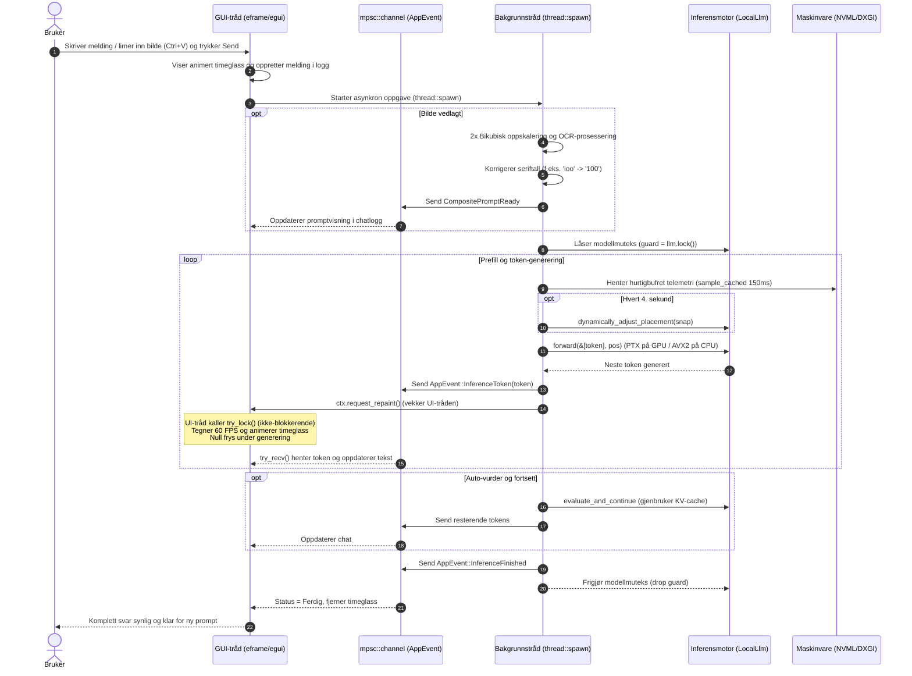
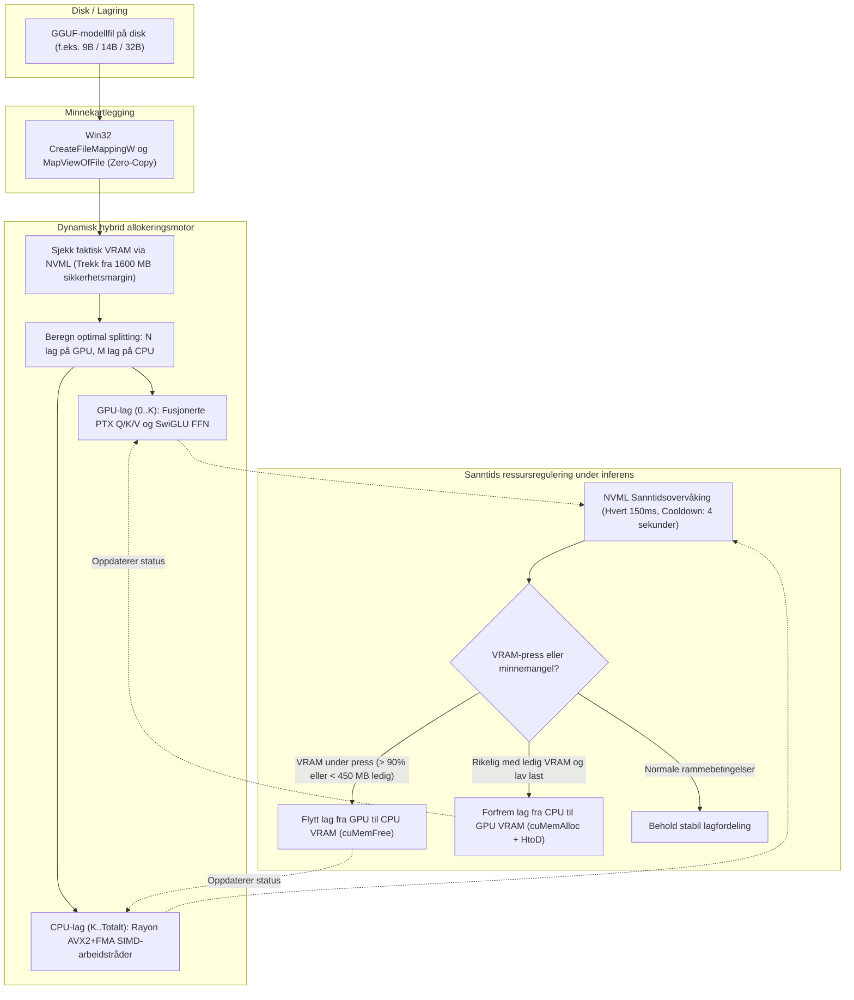
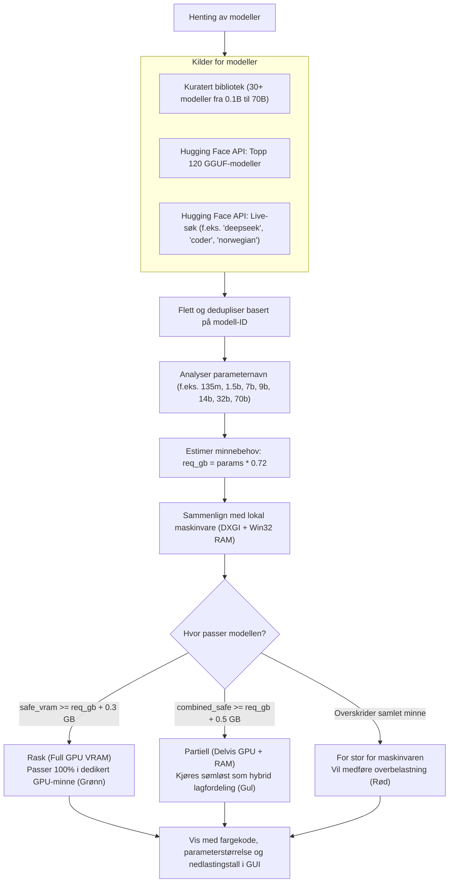

# Hugging Face Local Assistant

En Windows-applikasjon i Rust for utforsking, nedlasting og lokal kjøring av GGUF-språkmodeller med en egenutviklet GPU- og CPU-inferensmotor (CUDA Driver API PTX-kjerner og AVX2/FMA SIMD), minnekartlegging og dynamisk ressursstyring.


---

## Oversikt

Applikasjonen tilbyr et komplett miljø for å finne, vurdere og kjøre åpne språkmodeller lokalt på Windows. Løsningen inkluderer maskinvareanalyse via Windows DXGI og NVIDIA NVML, integrasjon mot Hugging Face Hub API, automatisk nedlasting av vekter og tokenizere, samt en egenutviklet hybrid GPU/CPU-inferensmotor med dynamisk ressursregulering implementert direkte i Rust.

---

## Arkitektur og kommunikasjonsflyt

### 1. Overordnet systemarkitektur

Systemet er organisert i uavhengige, asynkrone lag som sikrer høy ytelse, lav latens og fullstendig separasjon mellom brukergrensesnitt og regnekrevende matriseoperasjoner.



---

### 2. Tråd- og kommunikasjonsarkitektur (Sekvens)

Under inferens arbeider bakgrunnstråden og inferensmotoren i en egen tråd uten å blokkere Windows-hovedtråden. GUI-tråden leser modell- og hybridstatus via `try_lock()`, og tokens strømmes umiddelbart over en asynkron kanal.



---

### 3. Hybrid GPU/CPU-fordeling og dynamisk VRAM-håndtering

Når en modell overstiger dedikert GPU-minne, fordeler motoren lagene sømløst mellom GPU VRAM og system-RAM. Underveis overvåkes VRAM-forbruk med en 4-sekunders hysterese-cooldown for å forhindre unødig PCIe-overføring.



---

### 4. Modellutvalg, Hugging Face Hub-søk og FitLevel-beslutningstre

Hver modell evalueres matematisk mot den oppdagede maskinvaren for å avgjøre om den kan kjøres 100 % på GPU, som en stabil hybrid, eller om den krever for mye minne.



---

### 5. Multimodal OCR og sammensatt prompt-pipeline

Bilder fra utklippstavlen eller skjermklipp forbehandles, skaleres opp, rettes opp og analyseres med OCR før den utpakkede teksten settes sammen med samtalehistorikk og sendes til inferensmotoren.

```mermaid
flowchart LR
    subgraph Input["Bildeinput"]
        Paste["Ctrl+V fra utklippstavle"]
        Snip["Win+Shift+S skjermklipp"]
        Btn["'Lim inn bilde'-knapp"]
    end

    subgraph Preprocessing["Forbehandling"]
        Upscale["2x Bikubisk oppskalering"]
        Contrast["Gråtone og kontrastforbedring"]
        Deskew["Oppretting av skjev tekst"]
    end

    subgraph TextExtraction["Tekstgjenkjenning og rekonstruksjon"]
        OCR_Engine["RapidOCR / Windows Media OCR"]
        Layout["Layout-analyse: Bevar linjeskift, tabeller og avsnitt"]
        NumericTrap["Gjenoppretting av seriftall (f.eks. 'ioo' -> '100')"]
    end

    subgraph Composition["Prompt-sammensetting"]
        History["Samtalehistorikk formatert med [bruker] og [AI]"]
        UserText["Valgfri manuell ledetekst fra brukeren"]
        SysPrompt["System Prompt instruksjoner"]
        FinalPrompt["Komplett strukturert prompt"]
    end

    subgraph InferenceStream["Inferens og selvvurdering"]
        Prefill["Chunked Prefill"]
        Streaming["Token-strømming med animert timeglass"]
        Eval["Auto-vurder og fortsett uten re-prefill"]
    end

    Input --> Preprocessing
    Preprocessing --> TextExtraction
    TextExtraction --> Composition
    Composition --> InferenceStream
```



---

## Funksjonalitet og arkitektur

### 1. Maskinvareanalyse og dynamisk ressursstyring (`ResourceGovernor`)
- Registrerer CPU-arkitektur, antall logiske kjerner, totalt og ledig systemminne (RAM) samt tilgjengelig sidevekslingsfil via Win32 `GlobalMemoryStatusEx`.
- Identifiserer dedikert GPU-videominne (VRAM), sanntids GPU-last, VRAM-bruk og GPU-temperatur via Windows DXGI (`IDXGIFactory1`) og NVIDIA Management Library (`nvml.dll`).
- **Trygg sub-maksimal ressursbruk (GPU og CPU)**:
  - **VRAM-sikkerhetsmargin**: Ved modellinnlasting reserveres alltid minst 1,2–1,6 GB som fri margin slik at Windows Desktop Window Manager (DWM), brukergrensesnittet og andre åpne programmer aldri går tomme for videominne.
  - **Dynamisk GPU- og CPU-skalering**: Under normal drift reguleres antall samtidige CUDA thread-blocks på GPU og aktive `rayon`-arbeidstråder på CPU (~75 % av logiske kjerner med `THREAD_PRIORITY_BELOW_NORMAL`) slik at maskinen yter maksimalt innenfor trygge rammer.
- **Fokusbevisst skalering ved programbytte (`Alt+Tab`)**: Når applikasjonsvinduet mister fokus, skaleres både GPU-grid-størrelse, aktive CPU-tråder og UI-oppdateringsfrekvens automatisk ned for å gi full prioritet til det aktive programmet, og skaleres opp igjen når brukeren vender tilbake.
- **Automatisk håndtering av lavt minne og overbelastning**: Ved lavt tilgjengelig RAM/VRAM eller høy GPU-temperatur reduseres ressursbruken dynamisk med korte, avbrytbare mikropauser for å gi systemet pusterom uten at genereringen henger seg opp eller forårsaker sidefeil i minnekartlagte vekter.

### 2. Hugging Face Hub-integrasjon
- Søk og filtrering i åpne GGUF-modeller via Hugging Face REST API (Topp 120 + direkte live-søk).
- Kuratert bibliotek med over 30 verifiserte modeller innen DeepSeek-R1-Distill, Qwen2.5 / Coder, Llama 3.2 / 3.1, Gemma 2, Mistral, SmolLM2 og Phi.
- Hurtigfilterknapper i GUI for umiddelbar oppdeling etter modellstørrelse og familie.
- Strukturert forespørselshåndtering med egendefinert User-Agent, rate-limiting og eksponentiell tilbakeholdelse ved HTTP 429.
- Automatisk analyse og klassifisering av modeller basert på om de får plass i dedikert VRAM, system-RAM eller overskrider maskinvarens kapasitet.

### 3. Nedlasting og tokenisering
- Asynkron strømming av GGUF-filer med sanntids fremdriftsrapportering.
- Automatisk deteksjon og nedlasting av kompatibel `tokenizer.json` for valgt modell, inkludert oppslag mot opprinnelig basemodell der GGUF-depotet kun inneholder binærvekter.

### 4. Egenutviklet GPU- og CPU-inferensmotor
- **Direkte GPU-akselerasjon via CUDA Driver API (`nvcuda.dll`) og PTX**:
  - Egenutviklede warp-reduserende CUDA PTX-kjerner (`matmul_q4k`, `matmul_q6k`, `matmul_q5k`, `matmul_q8_0`, `matmul_q4_0`, `matmul_f16`, `matmul_bf16`, `matmul_f32` og `swiglu_f32`) lastes direkte inn via `nvcuda.dll` uten krav om eksterne biblioteker ved kjøring.
  - **Fusjonerte GPU-pipelines**: Q/K/V-projeksjoner og SSM-projeksjoner som deler samme input kjøres i grupperte GPU-kall med kun én PCIe-overføring, og hele SwiGLU Feed-Forward Network (`ffn_gate`, `ffn_up`, `swiglu_f32`, `ffn_down`) kjøres fusjonert i VRAM/L2-cache uten mellomliggende kopiering til CPU.
  - **Dynamisk hybrid GPU/CPU-fordeling (lagvis allokering og sanntidstilpasning)**:
    - Modeller som er for store til å passe i VRAM alene (f.eks. 9B, 14B eller 32B på 6 GB / 8 GB GPU), kjøres som en sømløs hybrid der en del av transformator-lagene akselereres i GPU VRAM og resterende lag kjøres på CPU.
    - Hvert lag håndteres som en koherent beregningsenhet slik at GPU-lagene fullt ut utnytter fusjonerte PTX-kjerner.
    - **Dynamisk tilpasning og hysterese-cooldown**: Fordelingen evalueres fortløpende mot NVML med minst 4 sekunders stabilitetsperiode for å unngå unødig lagflytting over PCIe under aktiv token-generering.
- **Zero-Copy minnekartlegging**: Benytter Win32 API (`CreateFileMappingW` og `MapViewOfFile`) for å kartlegge fler-gigabyte `.gguf`-filer direkte fra disk uten unødig allokering i sidevekslingsfilen.
- **Dynamisk oppdelt prefill (Chunked Prefill)**: Innkommende prompts prosesseres i dynamiske del-batches tilpasset ledig RAM og VRAM.
- **GGUF-parser**: Fullstendig parser for GGUF-formatversjoner 1, 2 og 3, inkludert metadatastruktur, arraytyper og tensordeskriptorer.
- **Modellarkitekturer**:
  - `qwen35`: Hybridarkitektur med Gated DeltaNet State Space Model (SSM) og Full Attention (støtter opptil 8192 tokens kontekstlengde).
  - Standard Transformer: Støtte for modeller basert på RoPE, RMSNorm og SiLU/SwiGLU (inkludert Llama-, Mistral-, Gemma- og Phi-varianter).
- **Sampling, repetisjonsvern og kontroll**: Temperatur- og Top-P-sampling, automatisk deteksjon av n-gram-repetisjonsløkker samt umiddelbar avbruddshåndtering via atomiske flagg.

### 5. Brukergrensesnitt
- **Grafisk grensesnitt (GUI)**: Bygget med `eframe` og `egui`.
  - **100 % ikke-blokkerende trådmodell**: Hovedtråden benytter `try_lock()` og asynkrone kanaler slik at brukergrensesnittet holder jevn 60 FPS og aldri fryser under krevende inferens.
  - **Animert timeglass**: Under ventetid (prefill og generering) vises et animert timeglass i prompt-feltet, i chat-visningen og i statuslinjen nederst.
  - Topp-panel med sanntidsoversikt over maskinvare, aktiv ressursmodus, mengde modellvekter i GPU VRAM, GPU-last (%), GPU-temperatur, aktive CPU-tråder og tilgjengelig systemminne.
  - Modellutforsker med hurtigfiltre, direkte live-søk og sanntids fargekoding.
  - Lokal filoversikt med status for nedlastede vekter og tokenizere.
  - Dedikert fane for vurdering, justering og forhåndsgodkjenning av systeminstruksjoner (System Prompt).
  - Samtalepanel med høykontrast-tekst, justerbare inferensparametere og avbryt-funksjon.
  - Samtalekontekst med støtte for fler-stegs samtaler formatert kronologisk med `[bruker]` og `[AI]` adskilt med mellomrom, samt tilhørende tolkningsinstruks i System Prompt.
  - **Avansert OCR og bildevedlegg i prompt**:
    - Mulighet for å lime inn flere bilder direkte inn i promptfeltet (via utklippstavle med `Ctrl+V`, skjermklipp via `Win+Shift+S`, eller eksplisitt knapp).
    - Hvert vedlagte bilde vises som et miniatyrbilde (thumbnail) med knapp for fjerning.
    - 2x bikubisk oppskalering, linjeskift- og layout-rekonstruksjon, samt automatisk gjenoppretting av numeriske seriffeller (f.eks. `100` vs `ioo`).
  - **Tilstandsbasert automatisk selvvurdering og fortsettelse (Auto-vurder og fortsett)**:
    - Dersom genereringen treffer token-grensen midt i en setning, fullføres den påbegynte setningen sømløst direkte fra eksisterende token-posisjon.
    - Deretter gjenbrukes eksisterende KV-cache og SSM-tilstand til å raskt vurdere om svaret er fullstendig og godt nok uten å måtte prosessere hele samtalen på nytt. Hvis svaret er ufullstendig, fortsetter modellen automatisk inntil svaret er komplett.
  - Egen funksjon for øyeblikkelig nullstilling av samtalelogg (Reset chat).
- **Kommandolinjegrensesnitt (CLI)**: Støtte for ren terminalbasert interaksjon via flagget `--cli` med støtte for samtalehistorikk og `reset`-kommando.

---

## Systemkrav

- Operativsystem: Windows 10 eller Windows 11 (64-bit x86_64)
- Prosessor: x86_64-prosessor med støtte for AVX2 og FMA instruksjonssett
- Grafikkort (valgfritt, anbefalt): NVIDIA GPU med CUDA Driver API (`nvcuda.dll`) for maskinvareakselerert GGUF-inferens i VRAM
- Kompilator: Rust 1.75 eller nyere (ved kompilering fra kildekode)

---

## Kompilering og oppstart

### Kompilering (Release)
```powershell
cargo build --release
```

### Starte grafisk grensesnitt (GUI)
```powershell
cargo run --release
```

### Starte kommandolinjegrensesnitt (CLI)
```powershell
cargo run --release -- --cli
```

### Bygge Windows MSI-installasjonspakke
For å bygge en frittstående Windows MSI-installasjonspakke (`HuggingFaceLocalAssistant.msi`):
```powershell
powershell -ExecutionPolicy Bypass -File installer\build_msi.ps1
```
Installasjonspakken oppretter automatisk snarveier på skrivebordet og i Start-menyen, installerer applikasjonen og nødvendige biblioteker i `Program Files`, og gir en ren avinstallasjonsmulighet via Windows *Legg til eller fjern programmer*.

---

## Prosjektstruktur

```
docs/
  ARCHITECTURE.md     Komplett arkitekturspesifikasjon med diagrammer
installer/
  Package.wxs         WiX Toolset v4 definisjon for MSI-installasjonspakken
  License.rtf         Sluttbrukeravtale (EULA) for installasjonsveiviseren
  build_msi.ps1       Byggescript for release-kompilering og MSI-pakking
src/
  main.rs             Inngangspunkt for applikasjonen (velger GUI eller CLI)
  ui.rs               Grafisk brukergrensesnitt implementert med egui/eframe
  gpu.rs              CUDA Driver API (nvcuda.dll) PTX-akselerator og NVML GPU-telemetri
  gguf_kernels.ptx    Forhåndskompilerte CUDA PTX-kjerner for kvantiserte matriseoperasjoner og SwiGLU
  inference.rs        Egenutviklet inferensmotor (GGUF-parser, Win32 mmap, GPU/CPU-dispatch, KV-cache gjenbruk)
  ocr.rs              OCR-integrasjon og utklippstavlehåndtering
  hardware.rs         Maskinvaredeteksjon via Windows DXGI/NVML og dynamisk ressursstyring (ResourceGovernor)
  hf_client.rs        Klient mot Hugging Face Hub API med hastighetsbegrensning
  recommender.rs      Beregning av minnebehov og maskinvarekompatibilitet
  downloader.rs       Håndtering av filnedlastinger og oppløsning av tokenizer
tools/
  ocr_engine.py       RapidOCR layout- og linjeskiftrekonstruksjon
```
