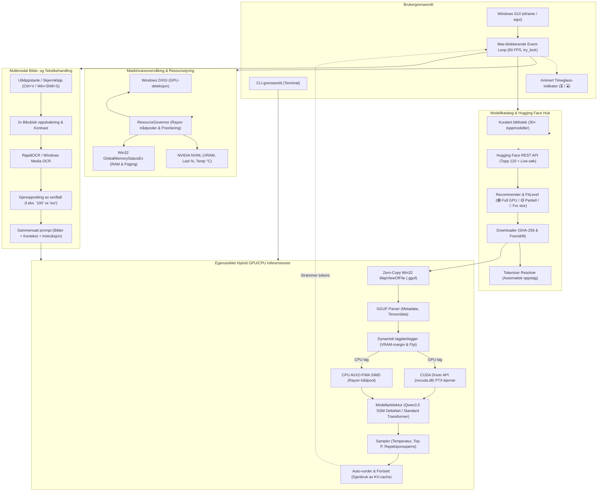
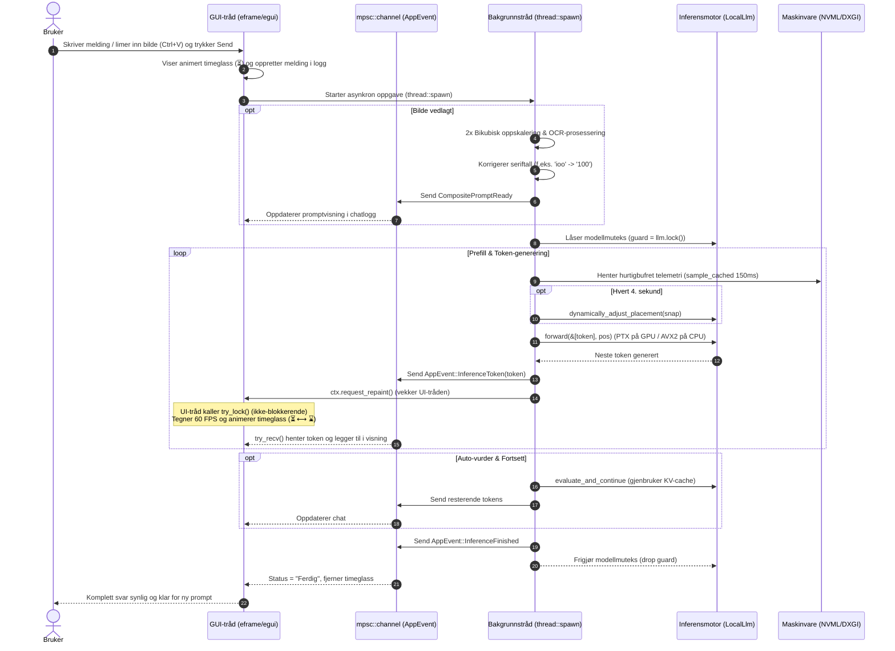
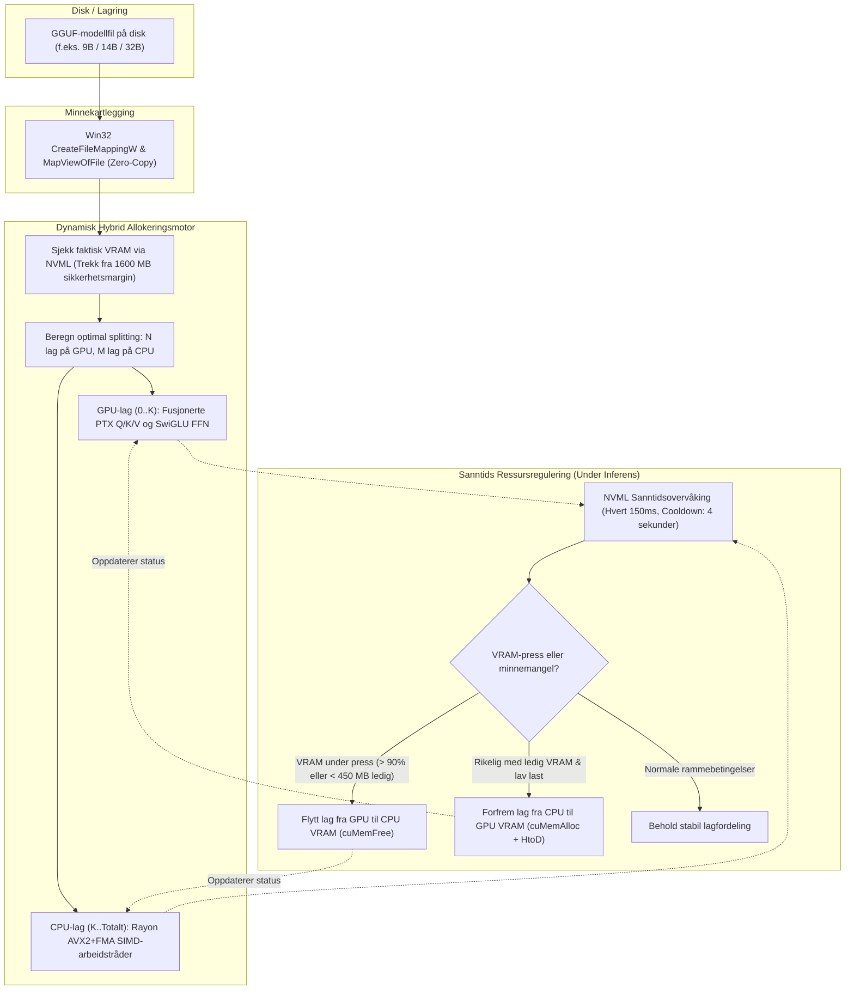
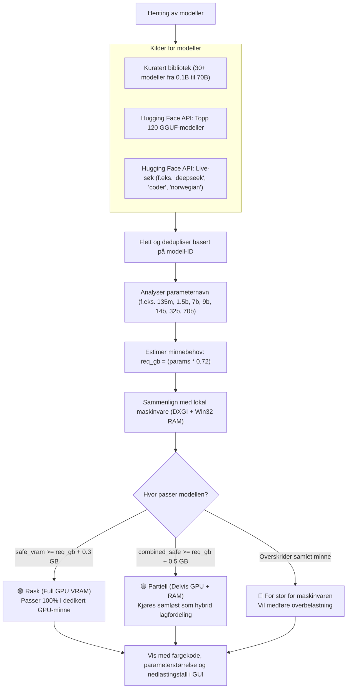

# Arkitektur og Kommunikasjonsflyt

Dette dokumentet gir en grundig teknisk gjennomgang av arkitekturen, trådmodellen, dataflyten og maskinvareintegrasjonen i **Hugging Face Local Assistant**.

---

## Innholdsfortegnelse
1. [Overordnet systemarkitektur](#1-overordnet-systemarkitektur)
2. [Trådmodell og asynkron kommunikasjonsflyt](#2-trådmodell-og-asynkron-kommunikasjonsflyt)
3. [Hybrid GPU/CPU-allokering og dynamisk minneflyt](#3-hybrid-gpucpu-allokering-og-dynamisk-minneflyt)
4. [Modellutvalg, Hugging Face Hub-søk og FitLevel-beslutningstre](#4-modellutvalg-hugging-face-hub-søk-og-fitlevel-beslutningstre)
5. [Multimodal OCR og sammensatt prompt-pipeline](#5-multimodal-ocr-og-sammensatt-prompt-pipeline)
6. [Tekniske detaljer om delsystemer](#6-tekniske-detaljer-om-delsystemer)

---

## 1. Overordnet systemarkitektur

Systemet er inndelt i modulære lag der brukergrensesnitt, maskinvareovervåking, modellutforsking, bildebehandling og inferensmotor opererer koordinert uten å blokkere hverandre.

---

## 2. Trådmodell og asynkron kommunikasjonsflyt

For å sikre at Windows-brukergrensesnittet aldri fryser eller havner i *"Not Responding"*-tilstand under krevende matriseoperasjoner, benytter applikasjonen en strengt ikke-blokkerende meldingskø (`std::sync::mpsc::channel`) mellom hovedtråden og bakgrunnstrådene.

---

## 3. Hybrid GPU/CPU-allokering og dynamisk minneflyt

Når en modell er for stor til å få plass i dedikert GPU-minne alene, fordeles lagene sømløst mellom GPU VRAM og system-RAM. Motoren overvåker faktisk VRAM-bruk i sanntid og flytter lag dynamisk med innebygd hysterese for å forhindre PCIe-metning.

---

## 4. Modellutvalg, Hugging Face Hub-søk og FitLevel-beslutningstre

Modellkatalogen kombinerer en kuratert samling av verifiserte modeller med live-oppslag mot Hugging Face Hub API. Hver modell analyseres matematisk mot brukerens lokale maskinvare og klassifiseres med fargekoder.

---

## 5. Multimodal OCR og sammensatt prompt-pipeline

Bildeinnliming og skjermklipp forbehandles med bildeoppskalering og optisk tegngjenkjenning før teksten kombineres med samtalehistorikk og sendes til inferensmotoren.

```mermaid
flowchart LR
    subgraph Input["Bildeinput"]
        Paste["Ctrl+V fra utklippstavle"]
        Snip["Win+Shift+S skjermklipp"]
        Btn["'Lim inn bilde'-knapp"]
    end

    subgraph Preprocessing["Forbehandling"]
        Upscale["2x Bikubisk oppskalering"]
        Contrast["Gråtone & Kontrastforbedring"]
        Deskew["Oppretting av skjev tekst"]
    end

    subgraph TextExtraction["Tekstgjenkjenning & Rekonstruksjon"]
        OCR_Engine["RapidOCR / Windows Media OCR"]
        Layout["Layout-analyse: Bevar linjeskift, tabeller & avsnitt"]
        NumericTrap["Gjenoppretting av seriftall (f.eks. 'ioo' -> '100')"]
    end

    subgraph Composition["Prompt-sammensetting"]
        History["Samtalehistorikk formatert med [bruker] og [AI]"]
        UserText["Valgfri manuell ledetekst fra brukeren"]
        SysPrompt["System Prompt instruksjoner"]
        FinalPrompt["Komplett strukturert prompt"]
    end

    subgraph InferenceStream["Inferens & Selvvurdering"]
        Prefill["Chunked Prefill"]
        Streaming["Token-strømming med animert timeglass (⏳)"]
        Eval["Auto-vurder & fortsett uten re-prefill"]
    end

    Input --> Preprocessing
    Preprocessing --> TextExtraction
    TextExtraction --> Composition
    Composition --> InferenceStream
```

---

## 6. Tekniske detaljer om delsystemer

### A. Ikke-blokkerende UI og responsivitet
- **`try_lock()`-mønster**: Hovedtråden i Windows kaller utelukkende `self.loaded_llm.try_lock()` for å avlese modellstatus og lagplassering. Dersom inferenstråden arbeider, returneres umiddelbart sist hurtigbufrede `HybridStatus`. Hovedtråden venter aldri på en `Mutex`-lås, noe som eliminerer vindusfrys og *"Not Responding"*.
- **Animert timeglass**: Under ventetid (prefill og token-generering) animeres timeglasset (`⏳` ⟷ `⌛`) jevnt i prompt-feltet, chat-boblen og statuslinjen ved å hente tidsstempel fra `egui::Context::input` og forespørre opptegning med 50 ms intervall.

### B. Dynamisk ressursregulering (`ResourceGovernor`)
- **Fokusbevissthet**: Applikasjonen detekterer om vinduet er aktivt via `egui::Context::input(|i| i.focused)`. Ved `Alt+Tab` reduseres GPU-grid-størrelse, CPU-tråder og bildefrekvens for å overlate systemressurser til andre applikasjoner.
- **Hurtigbufret telemetri**: `ResourceGovernor::sample_cached` begrenser direkte kall mot Win32 `GlobalMemoryStatusEx` og NVIDIA NVML C API til maksimalt ett oppslag per 150 ms under aktiv inferens, noe som eliminerer unødvendig kjerne-overhead.
- **Minnesikkerhet**: Working set for prosessen tømmes aldri under aktiv token-generering, slik at minnekartlagte vekter forblir varme i minnet uten sidefeil (page faults).

### C. Hybrid inferensmotor
- **CUDA PTX-kjerner**: Egendefinerte PTX-kjerner for kvantiserte matriseoperasjoner (`matmul_q4k`, `matmul_q6k`, `matmul_q5k`, `matmul_q8_0`, `matmul_q4_0`, `matmul_f16`, `matmul_bf16`, `matmul_f32`) og fusjonert SwiGLU FFN (`swiglu_f32`) lastes direkte via `nvcuda.dll` uten eksterne runtime-avhengigheter.
- **AVX2+FMA CPU-kjerner**: Resterende lag kjøres over Rayon parallell trådpool konfigurert med sub-maksimal trådmengde og `THREAD_PRIORITY_BELOW_NORMAL`.
- **Tilstandsbevarende auto-vurdering**: Modellen gjenbruker sin eksisterende KV-cache og State Space Model (SSM)-tilstand for å vurdere svaret og fullføre avkuttede setninger uten å måtte kjøre oppstarts-prefill på nytt.
